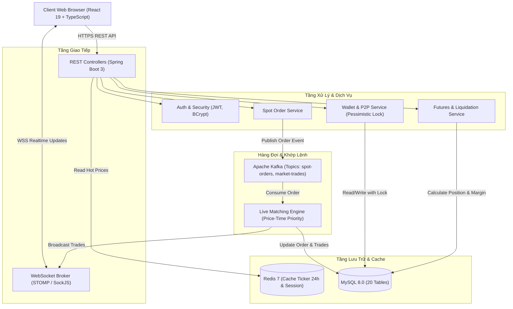
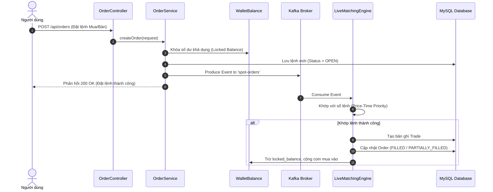
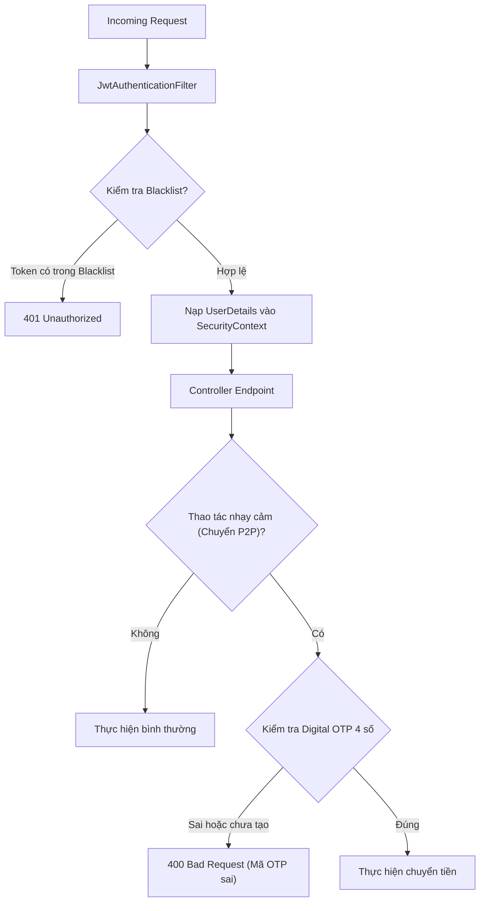
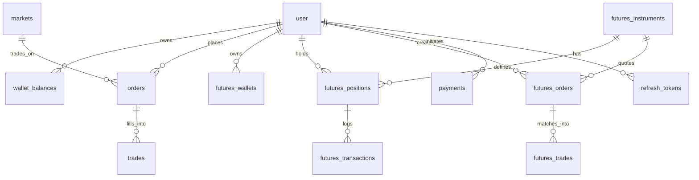

#  ARCHITECTURE.md - TÀI LIỆU KIẾN TRÚC HỆ THỐNG
> **Dự án**: TVN Exchange  
> **Phiên bản**: v2.5.0  

---

##  MỤC LỤC
1. [Sơ Đồ Kiến Trúc Tổng Thể](#1-sơ-đồ-kiến-trúc-tổng-thể)
2. [Kiến Trúc Phân Tầng Backend](#2-kiến-trúc-phân-tầng-backend)
3. [Luồng Xử Lý Khớp Lệnh Bất Đồng Bộ (Kafka Event-Driven)](#3-luồng-xử-lý-khớp-lệnh-bất-đồng-bộ-kafka)
4. [Kiến Trúc Giao Dịch Futures & Quản Trị Rủi Ro](#4-kiến-trúc-giao-dịch-futures--quản-trị-rủi-ro)
5. [Kiến Trúc Bảo Mật & Xác Thực Đa Lớp](#5-kiến-trúc-bảo-mật--xác-thực-đa-lớp)
6. [Sơ Đồ Quan Hệ Cơ Sở Dữ Liệu (Database ERD)](#6-sơ-đồ-quan-hệ-cơ-sở-dữ-liệu-erd)

---

## 1. SƠ ĐỒ KIẾN TRÚC TỔNG THỂ



---

## 2. KIẾN TRÚC PHÂN TẦNG BACKEND

```
[ HTTP Requests ]
       │
       ▼
[ Controller Layer ]      -> Nhận request, Validate (@Valid), chuyển đổi DTO
       │
       ▼
[ Service Layer ]         -> Business Logic, Quản lý giao dịch (@Transactional), Kiểm tra OTP
       │
       ▼
[ Repository Layer ]      -> Spring Data JPA, Khóa bi quan (@Lock PESSIMISTIC_WRITE)
       │
       ▼
[ Database Layer (MySQL)] -> Lưu trữ dữ liệu quan hệ ACID
```

---

## 3. LUỒNG XỬ LÝ KHỚP LỆNH BẤT ĐỒNG BỘ (KAFKA)



---

## 4. KIẾN TRÚC GIAO DỊCH FUTURES & QUẢN TRỊ RỦI RO

1. **Chế độ ký quỹ Isolated**: Mỗi vị thế mở có một hạn mức ký quỹ riêng biệt (`lockedMargin`), không làm ảnh hưởng đến số dư còn lại của ví.
2. **Công thức tính rủi ro**:
   - `Initial Margin` = `(Position Size * Entry Price) / Leverage`
   - `Maintenance Margin` = `Position Size * Mark Price * MMR`
   - `Liquidation Price`:
     - Long: `Entry Price - (Initial Margin - Maintenance Margin) / Position Size`
     - Short: `Entry Price + (Initial Margin - Maintenance Margin) / Position Size`
3. **Cơ chế Reduce-Only**: Chặn người dùng đặt thêm lệnh đối ứng nếu đã có sẵn lệnh đóng 100% vị thế, ngăn ngừa việc vị thế bị đảo chiều ngoài ý muốn.

---

## 5. KIẾN TRÚC BẢO MẬT & XÁC THỰC ĐA LỚP



---

## 6. SƠ ĐỒ QUAN HỆ CƠ SỞ DỮ LIỆU (ERD)


